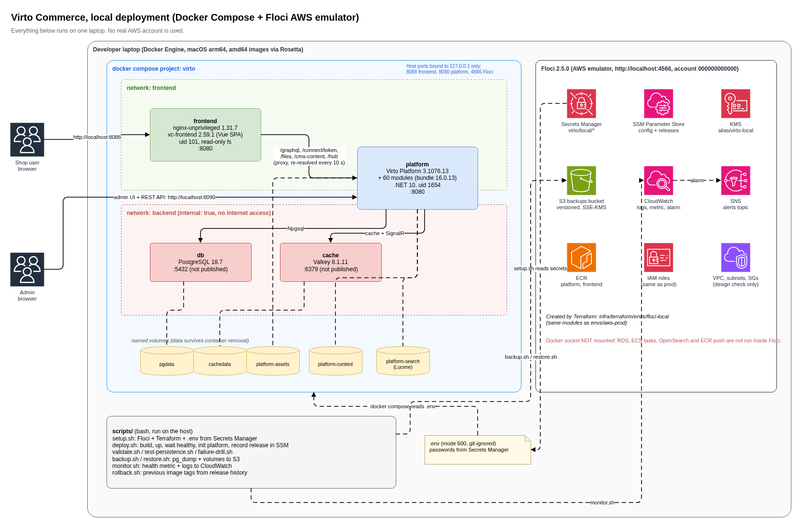
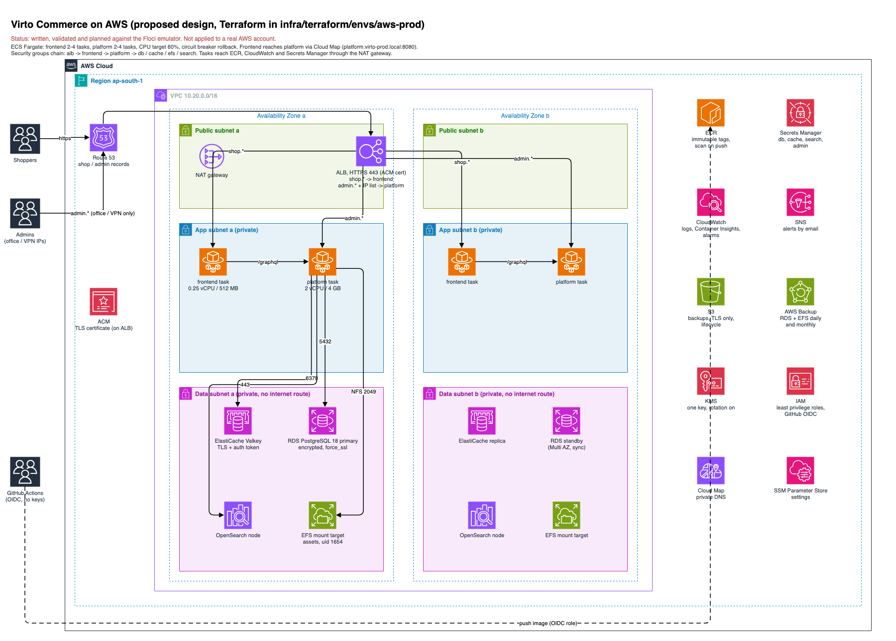

# Virto Commerce: Docker, Floci and AWS deployment

Deployment of the Virto Commerce Platform (backend) and vc-frontend (storefront)
with Docker Compose, the AWS side emulated locally with Floci, and Terraform
for a production setup on AWS (ECS Fargate, RDS, ElastiCache, OpenSearch).

**What is real and what is not**

| | Status |
|---|---|
| Local Docker deployment | running and tested (24 automated checks, persistence, failure, backup/restore and rollback tests) |
| Emulated AWS (Floci) | Terraform applied; secrets, backups, release history, logs and alarms used by the scripts |
| Real AWS | **not deployed**. Terraform written, validated and planned against Floci only |



## Contents

1. [Architecture](#1-architecture)
2. [Prerequisites and tool versions](#2-prerequisites-and-tool-versions)
3. [Repository structure](#3-repository-structure)
4. [Configuration and environment variables](#4-configuration-and-environment-variables)
5. [Local setup and deployment](#5-local-setup-and-deployment)
6. [Floci setup and resource provisioning](#6-floci-setup-and-resource-provisioning)
7. [Real AWS deployment](#7-real-aws-deployment)
8. [Ports and endpoints](#8-ports-and-endpoints)
9. [Database initialisation and persistence](#9-database-initialisation-and-persistence)
10. [Health checks and testing](#10-health-checks-and-testing)
11. [Logs and troubleshooting](#11-logs-and-troubleshooting)
12. [Security](#12-security)
13. [Backup, restore and rollback](#13-backup-restore-and-rollback)
14. [Cleanup](#14-cleanup)
15. [AWS cost estimate](#15-aws-cost-estimate)
16. [Known limitations and improvements](#16-known-limitations-and-improvements)

Presentation: [presentation](presentation/).

## 1. Architecture

- **frontend**: nginx serving the vc-frontend Vue app. It also proxies
  `/graphql`, `/connect/token` and a few other paths to the platform, so the
  browser talks to one origin.
- **platform**: Virto Platform 3.1076.13 with 60 modules (official bundle
  16.0.13 + OpenSearch module). Admin UI, REST and GraphQL API, background jobs.
- **db**: PostgreSQL 18.7. **cache**: Valkey 8.1 (Redis compatible).
- db and cache sit on an internal Docker network with no internet access.
- **Floci** emulates the AWS services the scripts use: Secrets Manager, SSM,
  S3, KMS, CloudWatch, SNS, IAM, ECR, VPC.

Diagrams: `docs/diagrams/architecture.drawio` (2 pages, open in draw.io),
PNG exports [local](docs/diagrams/architecture-local.png) and
[AWS](docs/diagrams/architecture-aws.png).

## 2. Prerequisites and tool versions

Tested with:

| Tool | Version | Needed for |
|---|---|---|
| Docker Engine | 29.8 | everything |
| Docker Compose | v2 (plugin) | everything |
| Terraform | 1.15.4 (>= 1.6 for floci-local, >= 1.10 for aws-prod) | Floci and AWS infra |
| AWS CLI | 2.34 | Floci |
| bash, curl, python3, openssl | any recent | scripts |

Machine: 4 CPU and 8 GB RAM for Docker at least (the platform alone uses about
2 GB). About 4 GB of disk for images. Tested on macOS 26 on Apple Silicon (the
Virto images are amd64 and run through Rosetta) and in CI on Ubuntu 24.04.

## 3. Repository structure

```
.
├── docker-compose.yml            local stack: frontend, platform, db, cache
├── .env.example                  configuration template (no real secrets)
├── Makefile                      shortcuts for the scripts
├── docker/
│   ├── platform/                 Dockerfile, modules.json (bundle), modules.lock (60 module URLs)
│   └── frontend/                 Dockerfile, nginx config template
├── infra/
│   ├── floci/docker-compose.yml  Floci AWS emulator
│   └── terraform/
│       ├── modules/              network, storage, secrets, registry, iam, observability, data, app
│       ├── envs/floci-local/     emulator environment (applied)
│       ├── envs/aws-prod/        real AWS environment (not applied)
│       └── floci-overrides/      used to plan aws-prod against Floci
├── scripts/                      setup, deploy, validate, tests, backup, restore, rollback, monitor
├── .github/workflows/ci.yml      lint, terraform, build + scan, e2e, deploy (manual)
├── docs/                         diagrams (draw.io + PNG) and test evidence
│   ├── diagrams/                 draw.io source + PNG
│   └── evidence/                 real outputs of test runs and screenshots
└── presentation/                 slides
```

## 4. Configuration and environment variables

All settings are in `.env` (created from `.env.example`). `setup.sh` fills the
passwords from Secrets Manager on Floci. `.env` is git-ignored and written with
mode 600.

| Variable | Default | Meaning |
|---|---|---|
| `PLATFORM_IMAGE` | `ghcr.io/virtocommerce/platform:3.1076.13` | official base image |
| `PLATFORM_LOCAL_IMAGE` | `virto-platform:3.1076.13-b16.0.13` | tag of the image we build (platform + modules) |
| `FRONTEND_VERSION` | `2.59.1` | vc-frontend release |
| `FRONTEND_LOCAL_IMAGE` | `virto-frontend:2.59.1` | tag of the frontend image |
| `FRONTEND_PORT` | `8088` | storefront on the host |
| `PLATFORM_PORT` | `8090` | admin UI / API on the host |
| `PLATFORM_PUBLIC_URL` | `http://localhost:8090` | public URL for asset links |
| `POSTGRES_DB`, `POSTGRES_USER` | `virto` | database |
| `POSTGRES_PASSWORD` | from Secrets Manager | |
| `CACHE_PASSWORD` | from Secrets Manager | Valkey `requirepass` |
| `VC_ADMIN_USER` / `VC_ADMIN_PASSWORD` | `admin` / from Secrets Manager | replaces the factory default `admin/store` |
| `AWS_ENDPOINT_URL` | `http://localhost:4566` | Floci |

The compose file maps these into ASP.NET Core settings, for example
`ConnectionStrings__VirtoCommerce`, `DatabaseProvider=PostgreSql`,
`Search__Provider=Lucene`. See `docker-compose.yml`.

## 5. Local setup and deployment

```bash
git clone <repo> && cd virto-commerce-devops

./scripts/setup.sh      # checks tools/ports, starts Floci, terraform apply, writes .env
./scripts/deploy.sh     # builds images, starts the stack, imports sample data,
                        # builds the search index, sets the admin password
./scripts/validate.sh   # 24 checks
```

Without Floci: `./scripts/setup.sh --offline` (random passwords instead of
Secrets Manager), then `deploy.sh`.

First run takes about 10 minutes, most of it downloading the 60 modules
(~300 MB) and the sample data (~60 MB). Later starts take under a minute.

Open:
- Storefront: http://localhost:8088
- Admin: http://localhost:8090, user `admin`, password = `VC_ADMIN_PASSWORD` in `.env`

Daily commands:

| Action | Command |
|---|---|
| start / stop (keep data) | `docker compose start` / `docker compose stop` |
| status | `docker compose ps` |
| logs | `docker compose logs -f platform frontend` |
| restart one service | `docker compose restart platform` |
| rebuild after a version change | `./scripts/deploy.sh` |

## 6. Floci setup and resource provisioning

```bash
docker compose -f infra/floci/docker-compose.yml up -d
export AWS_ACCESS_KEY_ID=test AWS_SECRET_ACCESS_KEY=test AWS_REGION=us-east-1
export AWS_ENDPOINT_URL=http://localhost:4566
aws sts get-caller-identity

terraform -chdir=infra/terraform/envs/floci-local init
terraform -chdir=infra/terraform/envs/floci-local apply
```

Creates a VPC with 6 subnets and 7 security groups, KMS key, versioned S3
backup bucket, 4 secrets, SSM parameters, 2 ECR repos, IAM roles, log groups,
SNS topic and an alarm. Evidence:
[docs/evidence/floci-resources.txt](docs/evidence/floci-resources.txt).

## 7. Real AWS deployment

Design: ALB with HTTPS, ECS Fargate (frontend + platform, 2 to 4 tasks each),
RDS PostgreSQL 18 Multi AZ, ElastiCache Valkey, OpenSearch, EFS, ECR, Secrets
Manager, CloudWatch, AWS Backup, GitHub OIDC for CI. Region ap-south-1.



Steps: bootstrap the state bucket, push images, apply, init the platform, hand over to CI.

```bash
make prod-validate      # terraform validate, no credentials needed
make prod-plan-floci    # plan the real AWS config against Floci (135 resources)
```

## 8. Ports and endpoints

| URL | What |
|---|---|
| http://localhost:8088 | storefront |
| http://localhost:8088/graphql | GraphQL through nginx |
| http://localhost:8088/nginx-health | frontend health |
| http://localhost:8090 | admin UI |
| http://localhost:8090/health | platform health (DB, Redis, modules, jobs) |
| http://localhost:8090/docs | Swagger (REST API) |
| http://localhost:8090/ui/graphiql | GraphQL playground |
| http://localhost:4566 | Floci |

db (5432) and cache (6379) are not published to the host. Everything is bound
to 127.0.0.1.

## 9. Database initialisation and persistence

- The platform creates and migrates the schema on first start (Entity
  Framework migrations, about 200 tables).
- `setup-platform.sh` imports the B2B sample store, builds the search index
  and replaces the default admin password. It is safe to run again.
- Data lives in named volumes: `virto_pgdata`, `virto_cachedata`,
  `virto_platform-assets`, `virto_platform-content`, `virto_platform-search`.
  Modules are inside the image on purpose (see architecture.md section 5).
- `./scripts/test-persistence.sh` proves it: writes a contact and a file,
  runs `docker compose down` + `up`, reads both back.

## 10. Health checks and testing

Every container has a health check (`/health`, `/nginx-health`, `pg_isready`,
`valkey-cli ping`) and `restart: unless-stopped`.

| Test | Command | Result |
|---|---|---|
| Smoke tests (24 checks) | `./scripts/validate.sh` | [24 passed](docs/evidence/) |
| Persistence after container removal | `./scripts/test-persistence.sh` | [passed](docs/evidence/persistence-test.txt) |
| Failure drills (DB outage, process crash) | `./scripts/failure-drill.sh` | [recovered](docs/evidence/failure-drill.txt) |
| Backup to S3 and restore | `./scripts/test-backup-restore.sh` | [passed](docs/evidence/backup-restore-test.txt) |
| Rollback | `./scripts/rollback.sh` | [passed](docs/evidence/rollback-test.txt) |
| Alerting | `./scripts/monitor.sh` | [alarm OK -> ALARM -> OK](docs/evidence/alarm-demo.txt) |

## 11. Logs and troubleshooting

```bash
docker compose logs -f --tail 100 platform     # app log (Serilog)
docker compose logs frontend                   # nginx access/error
curl -s localhost:8090/health | python3 -m json.tool
./scripts/monitor.sh                           # ship logs + metric to CloudWatch (Floci)
```

Logs rotate at 10 MB x 5 files per container.

Common problems: check `docker compose ps`, then the logs of the failing service, then `./scripts/validate.sh`.

## 12. Security

Short version:

- no secrets in Git; passwords generated by Terraform, stored in Secrets
  Manager, written to a mode 600 `.env`
- default `admin/store` password replaced and checked
- internal network for db/cache, no published DB ports, everything on 127.0.0.1
- non-root containers, read-only frontend filesystem
- pinned image versions, SHA256 check on the frontend zip, Trivy in CI
- AWS: TLS at the ALB, private subnets, SG chaining, least privilege IAM,
  KMS everywhere, admin UI limited to office/VPN IPs, GitHub OIDC

## 13. Backup, restore and rollback

```bash
./scripts/backup.sh                 # pg_dump + volumes -> backups/ and S3 (Floci)
./scripts/restore.sh --list
./scripts/restore.sh                # latest, verifies SHA256 first
./scripts/rollback.sh --list        # release history (also in SSM)
./scripts/rollback.sh               # previous image tags
./scripts/rollback.sh --restore-db  # + database from the pre-deploy backup
```

`deploy.sh` takes a `pre-deploy` backup automatically when the stack is
already running, because Virto migrates the schema on start.

## 14. Cleanup

```bash
./scripts/teardown.sh             # containers and networks, keeps data
./scripts/teardown.sh --volumes   # + database and files (asks for "yes")
./scripts/teardown.sh --all       # + Floci resources, Floci, local images
rm -rf backups/
```

## 15. AWS cost estimate

About **543 USD/month** for the production layout (2 AZ, HA everywhere),
about 150 USD for a staging setup. Biggest items: Fargate for the platform,
OpenSearch, RDS Multi AZ.

## 16. Known limitations and improvements

Limitations:
- Not deployed to real AWS (no approved account).
- Floci does not enforce IAM or network rules, and Docker backed services
  (RDS, ECS tasks, OpenSearch, ECR push) were not run inside Floci because that
  needs the Docker socket.
- Virto images are amd64 only: slower on Apple Silicon, no Graviton on AWS.
- Lucene search locally means one platform instance only.
- No TLS locally.
- `random_password` values are in Terraform state.

Next steps:
- RDS managed master password with rotation, cosign image signing.
- WAF and CloudFront in front of the ALB.
- OpenTelemetry module to X-Ray for tracing.
- Staging environment and a blue/green deploy with CodeDeploy.
- Run Floci with the Docker socket in a throwaway CI VM to test ECS tasks too.

## License

All rights reserved. The code can be reviewed and run for evaluation, but not reused without permission. See [LICENSE](LICENSE).
